  <picture>
    <source media="(prefers-color-scheme: dark)" srcset="assets/hero-dark.svg">
    
  </picture>

  
  
  

<!-- EDIT: About -->

## About

I'm a full stack developer. I build business websites, CRM systems and e-commerce stores for clients, working on the database, the backend and the pages people see. I like turning a client's requirement into a working, responsive website. After launch I can also take care of updates, bug fixes and on-page SEO, and I design social media posts when a project needs them.

**120+ projects · 2 years of experience · Planet Media Centre · PHP, Laravel, JavaScript, React**

<!-- /EDIT -->

<!-- EDIT: Tech Stack -->

## Tech Stack

### Frontend

       

### Backend

      

### Database & ORM

    

### Tools & Design

      

<!-- /EDIT -->

<!-- EDIT: Featured Projects -->

## Featured Projects

| Project                                                                                                               | Description                           | Stack                               |
| :-------------------------------------------------------------------------------------------------------------------- | :------------------------------------ | :---------------------------------- |
| **[Project Name](https://github.com/MohammadMahtab)** [Live demo](#) · [Source](https://github.com/MohammadMahtab) | One-line description of this project. | `PHP` `Laravel` `MySQL` `Bootstrap` |
| **[Project Name](https://github.com/MohammadMahtab)** [Live demo](#) · [Source](https://github.com/MohammadMahtab) | One-line description of this project. | `Node.js` `Express` `MongoDB`       |
| **[Project Name](https://github.com/MohammadMahtab)** [Live demo](#) · [Source](https://github.com/MohammadMahtab) | One-line description of this project. | `React` `Node.js` `Tailwind CSS`    |

<!-- /EDIT -->

## GitHub Stats

  <picture>
    <source media="(prefers-color-scheme: dark)" srcset="https://github-readme-stats-sage-nu-31.vercel.app/api?username=MohammadMahtab&show_icons=true&count_private=true&include_all_commits=true&hide_rank=true&card_width=450&hide_border=true&bg_color=0d1117&title_color=22D3EE&text_color=E6EDF3&icon_color=60A5FA">
    
  </picture>
  <picture>
    <source media="(prefers-color-scheme: dark)" srcset="https://github-readme-stats-sage-nu-31.vercel.app/api/top-langs?username=MohammadMahtab&layout=donut&langs_count=6&card_width=450&hide_border=true&bg_color=0d1117&title_color=22D3EE&text_color=E6EDF3">
    
  </picture>

  <picture>
    <source media="(prefers-color-scheme: dark)" srcset="https://streak-stats.demolab.com?user=MohammadMahtab&hide_border=true&background=0d1117&ring=22D3EE&fire=60A5FA&currStreakNum=E6EDF3&sideNums=E6EDF3&currStreakLabel=22D3EE&sideLabels=8B949E&dates=8B949E&stroke=8B949E">
    
  </picture>

  <picture>
    <source media="(prefers-color-scheme: dark)" srcset="https://github-readme-activity-graph.vercel.app/graph?username=MohammadMahtab&bg_color=0d1117&color=22D3EE&line=60A5FA&point=E6EDF3&area=true&area_color=22D3EE&hide_border=true&height=300&custom_title=Contribution%20Activity">
    
  </picture>

 

  <picture>
    <source media="(prefers-color-scheme: dark)" srcset="https://raw.githubusercontent.com/MohammadMahtab/MohammadMahtab/output/snake-dark.svg">
    
  </picture>

## Connect

  
  

